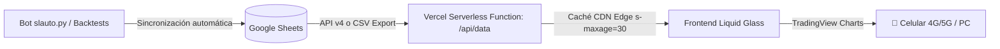

# SL AUTO · Quant & Backtest Hub (Vercel Serverless Edition)

Dashboard web de trading institucional con interfaz **Liquid Glass** y gráficos interactivos **TradingView Lightweight Charts**, alojado 100% en la nube sobre **Vercel Serverless**.

---

## 🏗️ Arquitectura Serverless



- **Frontend**: Single Page Application estática servida por la CDN global de Vercel (< 20ms de latencia en cualquier parte del mundo).
- **Backend**: Serverless Function en Node.js (`/api/data`) que lee en tiempo real de Google Sheets (`Detalle` y `Curvas PnL`), calcula métricas quant y devuelve JSON estructurado.
- **Resiliencia 100% Uptime**: Cuenta con fallback a snapshot local (`data/dashboard_data.json`). Si Google Sheets experimenta lentitud o mantenimiento, la aplicación jamás da error 500 y sigue operativa.

---

## 📁 Estructura del Proyecto

```text
vercel-dashboard/
├── api/
│   ├── data.js           # Serverless Function: lee Google Sheets y genera el dataset
│   ├── config.js         # Serverless Function: sincroniza preferencias de usuario
│   └── sync.js           # Serverless Function: fuerza refresco inmediato
├── data/
│   └── dashboard_data.json # Snapshot fallback de alta disponibilidad
├── public/
│   ├── index.html        # UI Liquid Glass intacta con dock iOS y orbes ambientales
│   ├── styles.css        # Estilos Liquid Glass oscuros y claros con refracción
│   ├── app.js            # Lógica cliente con Lightweight Charts y polling inteligente
│   └── lightweight-charts.js # Librería TradingView empaquetada (zero dependencias)
├── package.json          # Configuración del paquete Node
├── vercel.json           # Configuración de routing, CORS y caché Edge
└── README.md             # Guía de despliegue
```

---

## 🔑 Configuración de Google Sheets

Tenés dos opciones para que Vercel lea tu planilla:

### Opción A (La más rápida - Sin credenciales):
1. Abrí tu planilla en Google Sheets: `https://docs.google.com/spreadsheets/d/1LA62DNDVUce5e5772OiQlWOJZPvr4R6QYE8DMrUlDJU/edit`
2. Arriba a la derecha, hacé clic en **Compartir**.
3. En **Acceso general**, cambiá de *Restringido* a **Cualquier persona con el enlace** (rol: **Lector**).
4. ¡Listo! La función `/api/data` leerá automáticamente los datos vía endpoint seguro de Google.

### Opción B (Privada con API Key de Google Cloud):
1. Andá a [Google Cloud Console](https://console.cloud.google.com/) y creá una API Key con acceso a **Google Sheets API**.
2. En el panel de Vercel, agregá la variable de entorno:
   - `GOOGLE_API_KEY`: tu clave de API.
   - `SPREADSHEET_ID`: `1LA62DNDVUce5e5772OiQlWOJZPvr4R6QYE8DMrUlDJU` (opcional, ya viene por defecto).

---

## 🚀 Despliegue en Vercel (Paso a Paso)

### Método 1: Despliegue vía GitHub (Recomendado)
1. Subí la carpeta `vercel-dashboard` a un repositorio nuevo en tu cuenta de GitHub (puede ser privado o público).
2. Entrá en [vercel.com](https://vercel.com/) e iniciá sesión con tu cuenta de GitHub.
3. Hacé clic en **"Add New..."** ➔ **"Project"**.
4. Seleccioná tu repositorio y hacé clic en **Import**.
5. En **Environment Variables**, agregá opcionalmente:
   - `GOOGLE_API_KEY` (si elegiste la Opción B).
6. Hacé clic en **Deploy**.
7. En ~30 segundos Vercel te entregará tu enlace definitivo:  
   `https://slauto-dashboard.vercel.app`

### Método 2: Despliegue directo desde tu PC con Vercel CLI
1. Abrí una terminal en la carpeta `vercel-dashboard`:
   ```bash
   cd vercel-dashboard
   ```
2. Ejecutá Vercel CLI:
   ```bash
   npx vercel
   ```
3. Respondé las preguntas:
   - *Set up and deploy?* ➔ **Y**
   - *Which scope?* ➔ Seleccioná tu cuenta.
   - *Link to existing project?* ➔ **N**
   - *What's your project's name?* ➔ `slauto-dashboard`
   - *In which directory is your code located?* ➔ `./`
4. Para pasar a producción definitiva:
   ```bash
   npx vercel --prod
   ```

---

## 📱 Acceso desde Celular con Datos Móviles (4G/5G)
- El dominio `*.vercel.app` cuenta con certificado SSL global de Cloudflare/Vercel y está completamente homologado en todas las operadoras telefónicas móviles (Claro, Movistar, Personal).
- Podés agregarlo a la pantalla de inicio de tu iPhone o Android como una Web App (PWA) tocando en *"Añadir a pantalla de inicio"*.
